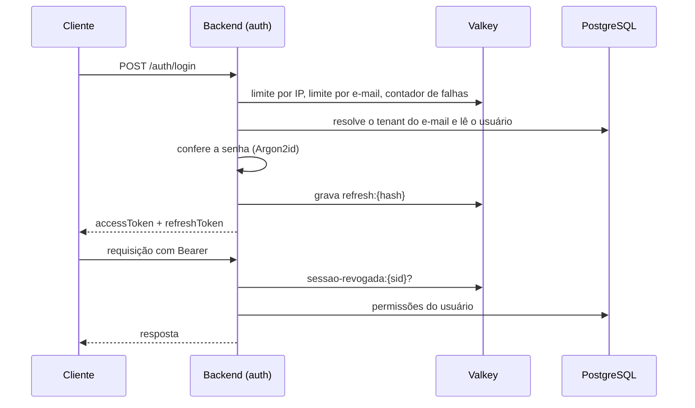
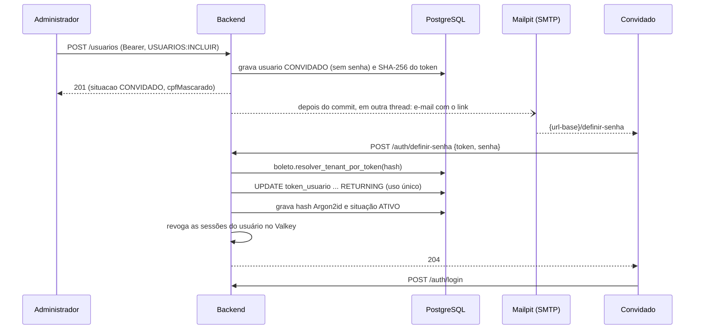
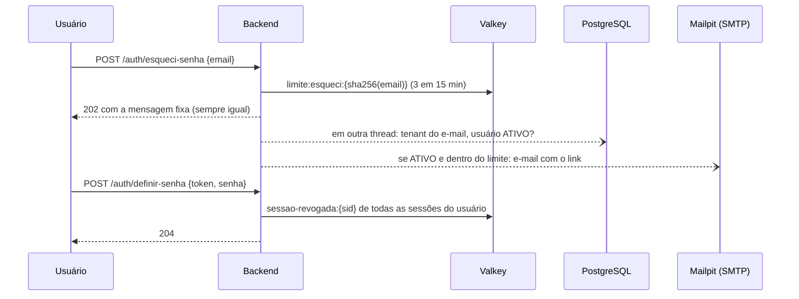

# Autenticação e autorização

Como o backend identifica quem chama a API e o que essa pessoa pode fazer. Decisões nos ADRs [0044](../adr/0044-jwt-es256-e-chave.md) a [0050](../adr/0050-contexto-de-tenant-jwt-e-threads.md) (Task 9) e [0051](../adr/0051-tokens-de-convite-e-recuperacao-de-senha.md) a [0053](../adr/0053-email-smtp-link-e-modelos.md) (Task 10). Esta página descreve o que os Tasks 9 e 10 implementaram; a situação das entregas está nos registros do [Task 9](../progresso/task-09-autenticacao-autorizacao.md) e do [Task 10](../progresso/task-10-convite-e-recuperacao-de-senha.md).

## Endpoints

| Endpoint | Autenticação | Função |
|---|---|---|
| `POST /auth/login` | pública | Recebe `{email, senha}` e devolve os tokens |
| `POST /auth/refresh` | pública | Recebe `{refreshToken}`, gira o refresh e devolve novos tokens |
| `POST /auth/logout` | access token | Revoga a sessão (`sid`) |
| `GET /auth/me` | access token | Devolve usuário, tenant efetivo, tenant de origem e permissões |
| `POST /auth/assumir-empresa` | access token + `PLATAFORMA_EMPRESAS:VISUALIZAR` | Recebe `{empresaId}` e devolve um access token para essa empresa |
| `POST /auth/definir-senha` | pública | Recebe `{token, senha}` e responde 204. Aceita o convite (`CONVIDADO` vira `ATIVO`) ou conclui a recuperação de senha. O token define qual dos dois |
| `POST /auth/esqueci-senha` | pública | Recebe `{email}` e responde sempre 202 com `{"mensagem":"Se o e-mail estiver cadastrado, enviaremos as instruções."}` |
| `POST /usuarios` | access token + `USUARIOS:INCLUIR` | Recebe `{nome, email, cpf?, perfilIds?}`, cria o usuário `CONVIDADO` e envia o convite. 201 |
| `POST /usuarios/{id}/convite` | access token + `USUARIOS:ALTERAR` | Reenvia o convite de um usuário `CONVIDADO` (senão 409). 204 |

Também são públicos `/actuator/health`, `/actuator/info` e, só com o springdoc ligado, o Swagger e `/v3/api-docs`. Todo o resto exige token.

Resposta de token: `{accessToken, refreshToken, tipo: "Bearer", expiraEm, sessaoExpiraEm}`. O `assumir-empresa` devolve só o access token.

## Token de acesso

JWT assinado com ES256 ([ADR 0044](../adr/0044-jwt-es256-e-chave.md)). Só referências, nenhum dado pessoal ([ADR 0045](../adr/0045-claims-tempos-e-sessao-diaria.md)):

| Claim | Conteúdo |
|---|---|
| `sub` | Id do usuário |
| `tid` | Tenant efetivo |
| `tor` | Tenant de origem |
| `sid` | Id da sessão |
| `jti`, `iss`, `aud`, `iat`, `nbf`, `exp` | Padrão JWT. `aud` vale `boleto-api` |

As permissões não vão no token. A cada requisição o backend lê `usuario_perfil` e `perfil_tela_permissao` e monta authorities `TELA:ACAO`.

## Tempos

| Item | Regra |
|---|---|
| Access | 1 hora, ou até `sessaoExpiraEm` se vier antes |
| Refresh | 8 horas, ou até `sessaoExpiraEm` se vier antes |
| Sessão | Até a próxima 00:00 do fuso `America/Sao_Paulo`. O refresh não a estende. O fuso do Brasil está confirmado pelo usuário do produto; a evolução prevista é usar o fuso de quem se loga ([ADR 0045](../adr/0045-claims-tempos-e-sessao-diaria.md)) |
| Token de convite | 72 horas, uso único |
| Token de recuperação | 30 minutos, uso único |

## Fluxos

Login com e-mail inexistente, senha errada, usuário inativo ou bloqueado devolve a mesma resposta (401 `CREDENCIAIS_INVALIDAS`) e custa o mesmo tempo: para e-mail inexistente o backend confere a senha contra um hash fictício.

### Refresh com rotação

1. O cliente envia o refresh. O backend calcula o SHA-256 e executa um script Lua que confere `sessao-revogada:{sid}` e o fim da sessão, apaga `refresh:{hash}`, grava `refresh-usado:{hash}` e grava o novo `refresh:{novo}`, tudo de forma atômica. O valor guarda o tenant de origem e o fim da sessão, então o refresh não consulta o banco para isso.
2. Se o refresh já foi usado, o mesmo script grava `sessao-revogada:{sid}` e devolve o `sid`: a sessão inteira cai e a resposta é 401 `REFRESH_REUTILIZADO`. De dois refreshs simultâneos com o mesmo token, só um passa.
3. Depois da meia-noite da sessão, o refresh falha e a pessoa faz login.

### Convite e definição de senha

O administrador reenvia o convite por `POST /usuarios/{id}/convite`: o token anterior é apagado e um novo é emitido. A página do link pertence ao frontend (Task 13); até lá o token é copiado do e-mail ([Convite e senha](../guias/convite-e-senha.md)).

### Esqueci minha senha

A resposta do `esqueci-senha` é idêntica (status, corpo e cabeçalhos, exceto `X-Trace-Id`) para e-mail existente, inexistente, `BLOQUEADO`, `INATIVO` e `CONVIDADO`. Só usuário `ATIVO` e dentro do limite recebe e-mail. Token inexistente, expirado, já usado ou de usuário em situação errada devolve sempre 400 `TOKEN_SENHA_INVALIDO`. Senha fraca devolve 400 `SENHA_FRACA` e não consome o token ([ADR 0052](../adr/0052-politica-de-senha.md)). Depois de definir a senha, todas as sessões do usuário caem e o contador de falhas de login é zerado. O fluxo não faz login automático.

### Logout

Grava `sessao-revogada:{sid}` com TTL fixo de 25 horas, maior que qualquer sessão. O access e o refresh dessa sessão deixam de valer. Um usuário que deixa de ser `ATIVO` também perde o acesso na hora: a situação é conferida a cada requisição (401 `TOKEN_INVALIDO`).

### Assumir empresa

Só a empresa da plataforma pode. O novo access leva `tid` da empresa escolhida e `tor` da plataforma, com o mesmo `sid` e o mesmo `exp`. Não há refresh para esse token. A cada requisição, o backend reconfere `PLATAFORMA_EMPRESAS:VISUALIZAR` do usuário de origem; se faltar, devolve 401. A auditoria grava o tenant de origem ([Multi-tenancy e auditoria](./multitenancy-e-auditoria.md)).

## Chaves do Valkey

| Chave | Valor | TTL |
|---|---|---|
| `refresh:{hash}` | `sid\|usuarioId\|tenantOrigem\|sessaoExpiraEm` (epoch em ms) | validade do refresh |
| `refresh-usado:{hash}` | `sid` | o que resta da sessão |
| `sessao-revogada:{sid}` | `1` | 25 horas no logout (mais que qualquer sessão); o que resta da sessão no reuso |
| `limite:ip:{ip}`, `limite:email:{sha256(email)}` | estado dos baldes do Bucket4j | gerido pela biblioteca |
| `login-falhas:{sha256(email)}` | contador de falhas | 15 minutos, fixo desde a 1ª falha |
| `sessoes-usuario:{usuarioId}` | conjunto dos `sid` das sessões abertas do usuário (Task 10) | 25 horas |
| `limite:esqueci:{sha256(email)}` | balde do Bucket4j: 3 pedidos por 15 minutos | gerido pela biblioteca |

Com o Valkey fora do ar, o backend responde 503 `SERVIDOR_INDISPONIVEL`. Ele nunca aceita um token sem consultar `sessao-revogada` ([ADR 0046](../adr/0046-refresh-e-blacklist-no-valkey.md)).

## Limites e bloqueio

[ADR 0047](../adr/0047-rate-limiting-e-bloqueio-de-conta.md): 30 requisições por minuto por IP em `/auth/**`; 10 tentativas de login por minuto por e-mail. Depois de 5 senhas erradas, a 6ª tentativa recebe 429 `LIMITE_EXCEDIDO` com `Retry-After`, sem conferir a senha. O login correto zera o contador. O IP vem do `remoteAddr`; o `X-Forwarded-For` só conta se o `remoteAddr` estiver em `boleto.seguranca.proxies-confiaveis`.

## Permissões nas rotas

Cada método de controller fora do módulo `auth` leva `@RequerPermissao(tela = ..., acao = ...)` ([ADR 0048](../adr/0048-permissoes-por-anotacao-e-assumir-empresa.md)). Uma regra do ArchUnit falha o build se faltar. A rota sem permissão devolve 403 `SEM_PERMISSAO`; sem token, 401 `NAO_AUTENTICADO`.

## Erros

Os códigos de autenticação e permissão estão em [Erros da API](./erros-da-api.md): `NAO_AUTENTICADO`, `CREDENCIAIS_INVALIDAS`, `TOKEN_INVALIDO`, `REFRESH_REUTILIZADO`, `SEM_PERMISSAO`, `LIMITE_EXCEDIDO` e `SERVIDOR_INDISPONIVEL` (Task 9), mais `TOKEN_SENHA_INVALIDO` e `SENHA_FRACA` (Task 10).

## Configuração

| Variável | Para que serve |
|---|---|
| `BOLETO_JWT_CHAVE_PRIVADA` | Chave privada ES256 (PEM PKCS#8 em base64, uma linha). Obrigatória fora do dev |
| `BOLETO_JWT_GERAR_CHAVE_EFEMERA` | `true` gera uma chave a cada início. Só dev. O Compose liga |
| `SPRING_DATA_REDIS_HOST`, `SPRING_DATA_REDIS_PORT`, `SPRING_DATA_REDIS_PASSWORD` | Conexão com o Valkey |
| `BOLETO_ADMIN_INICIAL_EMAIL`, `BOLETO_ADMIN_INICIAL_SENHA` | Administrador inicial ([ADR 0049](../adr/0049-administrador-inicial.md)). A senha segue a [política de senha](../adr/0052-politica-de-senha.md): 12 a 128 caracteres e fora da lista de senhas comuns |
| `SPRING_MAIL_HOST`, `SPRING_MAIL_PORT`, `SPRING_MAIL_USERNAME`, `SPRING_MAIL_PASSWORD` | SMTP dos e-mails de convite e recuperação. Padrão `localhost:1025` sem autenticação. O Compose aponta para o Mailpit |
| `BOLETO_APP_URL_BASE` | Base dos links dos e-mails, sem barra final. Padrão `http://localhost:4200`. Fora de `localhost` exige `https` |
| `BOLETO_EMAIL_REMETENTE` | Remetente dos e-mails. Padrão `Plataforma de Boletos <nao-responda@boleto.test>` |
| `BOLETO_PII_CPF_CHAVES_1` (e `_2`, `_3`), `BOLETO_PII_CPF_VERSAO_ATUAL`, `BOLETO_PII_CPF_INDICE_CHAVE` | Chaves do CPF cifrado ([Chaves de CPF](../guias/chaves-de-cpf.md)). Sem elas o backend não sobe |
| `BOLETO_PII_GERAR_CHAVES_EFEMERAS` | `true` gera chaves a cada início. Só testes automatizados, nunca o Compose |

O Compose de desenvolvimento define valores padrão para tudo isso, sem segredo real ([Compose de desenvolvimento](../guias/compose-dev.md)).

## Demonstração no Swagger

Com `docker compose up -d --build` rodando:

1. Abra `http://localhost:8080/swagger-ui.html`.
2. Em `POST /auth/login`, use "Try it out" com o administrador do Compose (`admin@boleto.test` e a senha padrão de dev do `docker-compose.yml`).
3. Copie o `accessToken`, clique em "Authorize" e cole o token.
4. Chame `GET /auth/me`. A resposta mostra o usuário, o tenant e as permissões.
5. Para ver o bloqueio, faça seis logins com senha errada: as cinco primeiras respondem 401 e a sexta responde 429.

O bloqueio dura 15 minutos, e mais de 10 logins do mesmo e-mail em um minuto também devolvem 429 (limite por e-mail). Para repetir a demonstração antes disso, limpe o Valkey de dev: `docker compose exec valkey valkey-cli -a valkey_dev --no-auth-warning FLUSHALL`.

## Pendências

- A tela do link do e-mail (`/definir-senha` e `/redefinir-senha`) é do frontend (Task 13). Até lá o token é copiado do e-mail.
- Tokens expirados ou usados continuam em `token_usuario`. A retenção e a limpeza ficam para o Task 15 ([Inventário LGPD](./inventario-lgpd.md)).
- Falha de envio de e-mail só gera log, sem retry nem métrica. A métrica entra no Task 11 ([ADR 0053](../adr/0053-email-smtp-link-e-modelos.md)).
- O frontend (Tasks 12 e 13) precisa guardar o refresh entre recarregamentos da página ([ADR 0046](../adr/0046-refresh-e-blacklist-no-valkey.md)).
- Fuso da sessão diária: o usuário confirmou `America/Sao_Paulo` por ora (só Brasil) e quer que a evolução siga o fuso de quem se loga. A pendência está no [registro do Task 9](../progresso/task-09-autenticacao-autorizacao.md) ([ADR 0045](../adr/0045-claims-tempos-e-sessao-diaria.md)).
