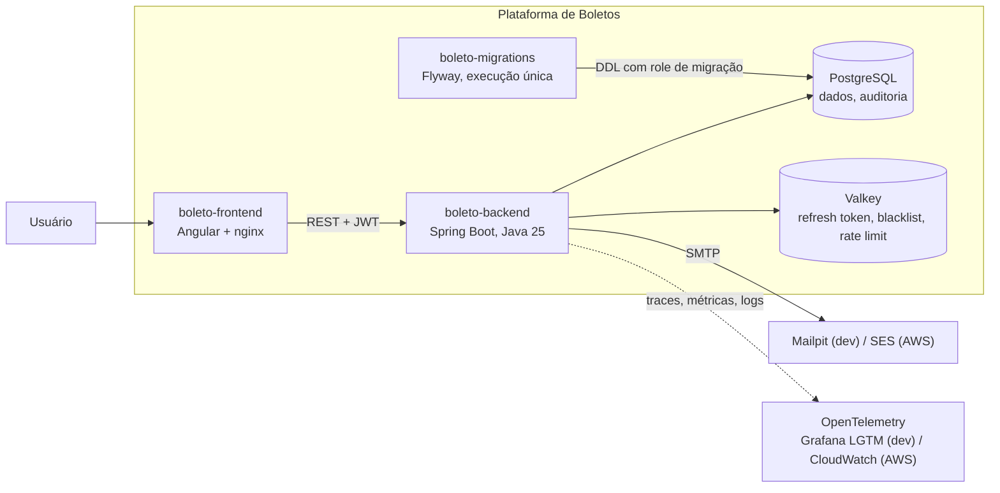

# Containers

## Responsabilidades

| Container | Responsabilidade |
|---|---|
| `boleto-frontend` | Interface do usuário. O cliente da API é gerado a partir do OpenAPI do backend |
| `boleto-backend` | Regras de negócio, autenticação, auditoria e API REST |
| `boleto-migrations` | Todo o schema do banco (tabelas, auditoria do Envers, políticas RLS, roles) |
| PostgreSQL | Dados transacionais e trilha de auditoria |
| Valkey | Refresh tokens, blacklist de logout e contadores de rate limit |
| Mailpit (só desenvolvimento) | Recebe por SMTP os e-mails enviados pelo backend e os mostra numa interface web |

## Papéis de banco de dados

O backend conecta com uma role sem permissão de DDL e sem `BYPASSRLS`. Só o `boleto-migrations` usa a role de migração. Assim uma falha na aplicação não consegue alterar o schema nem contornar o isolamento entre empresas.

## Ambientes

| Ambiente | PostgreSQL e Valkey | E-mail | Observabilidade |
|---|---|---|---|
| Desenvolvimento | Containers no Docker Compose (`docker-compose.yml` na raiz do `boleto-docs`, portas só em `127.0.0.1`, ver [Compose de desenvolvimento](../guias/compose-dev.md)) | Mailpit | Grafana LGTM (profile opcional, Task 11) |
| AWS (futuro) | RDS ou Aurora Serverless e ElastiCache for Valkey | Amazon SES | CloudWatch e X-Ray |
