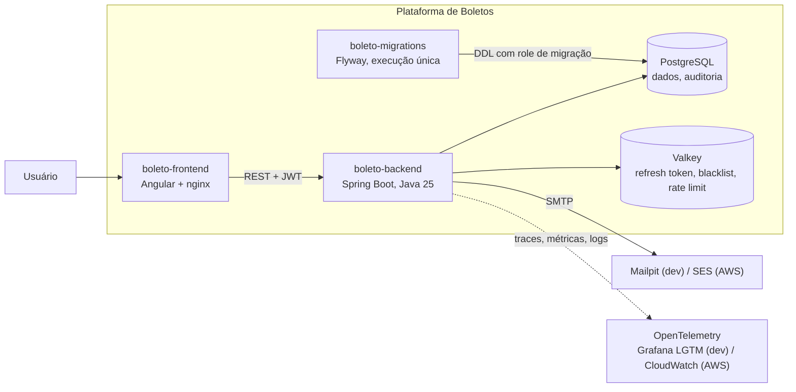

# Containers

## Responsabilidades

| Container | Responsabilidade |
|---|---|
| `boleto-frontend` | Interface do usuário. O cliente da API é gerado a partir do OpenAPI do backend |
| `boleto-backend` | Regras de negócio, autenticação, auditoria e API REST |
| `boleto-migrations` | Todo o schema do banco (tabelas, auditoria do Envers, políticas RLS, roles). Imagem de execução única: Flyway (JAR) sobre Amazon Corretto headless, Amazon Linux 2023 ([ADR 0024](../adr/0024-flyway-jar-corretto.md)) |
| PostgreSQL | Dados transacionais e trilha de auditoria |
| Valkey | Refresh tokens, blacklist de logout e contadores de rate limit |
| Mailpit (só desenvolvimento) | Recebe por SMTP os e-mails enviados pelo backend e os mostra numa interface web |

## Ordem de execução

A migração é o primeiro passo do deploy ([ADR 0027](../adr/0027-migracao-primeiro-passo.md)): a imagem do `boleto-migrations` roda uma vez, valida os checksums, aplica as migrações pendentes e sai com código diferente de zero em qualquer erro. Só se ela terminar com 0, o backend é publicado, e só depois dele o frontend. Na AWS (fora desta fase), a migração roda na VPC, por exemplo como tarefa do ECS Fargate, com a conexão em variáveis de ambiente. Em desenvolvimento, o serviço `flyway` do Compose (profile `migrations`) faz o mesmo papel como comando à parte: `docker compose run --build --rm flyway` ([Compose de desenvolvimento](../guias/compose-dev.md) e [Migrações do banco](../guias/migracoes.md)). A publicação da imagem num registro, multi-arquitetura (x64 e Graviton), e o encadeamento no pipeline ficam para o Task 14.

## Papéis de banco de dados

O backend conecta com uma role sem permissão de DDL e sem `BYPASSRLS`. Só o `boleto-migrations` usa a role administrativa de migração, que cria as roles `boleto_owner` (dona dos objetos), `boleto_app` (a do backend, só DML) e `boleto_funcoes` (dona das funções de resolução de tenant), com RLS ativo e forçado nas tabelas de tenant ([ADR 0026](../adr/0026-roles-e-rls.md)). Assim uma falha na aplicação não consegue alterar o schema nem contornar o isolamento entre empresas.

## Ambientes

| Ambiente | PostgreSQL e Valkey | E-mail | Observabilidade |
|---|---|---|---|
| Desenvolvimento | Containers no Docker Compose (`docker-compose.yml` na raiz do `boleto-docs`, portas só em `127.0.0.1`, ver [Compose de desenvolvimento](../guias/compose-dev.md)) | Mailpit | Grafana LGTM (profile opcional, Task 11) |
| AWS (futuro) | RDS ou Aurora Serverless e ElastiCache for Valkey | Amazon SES | CloudWatch e X-Ray |
