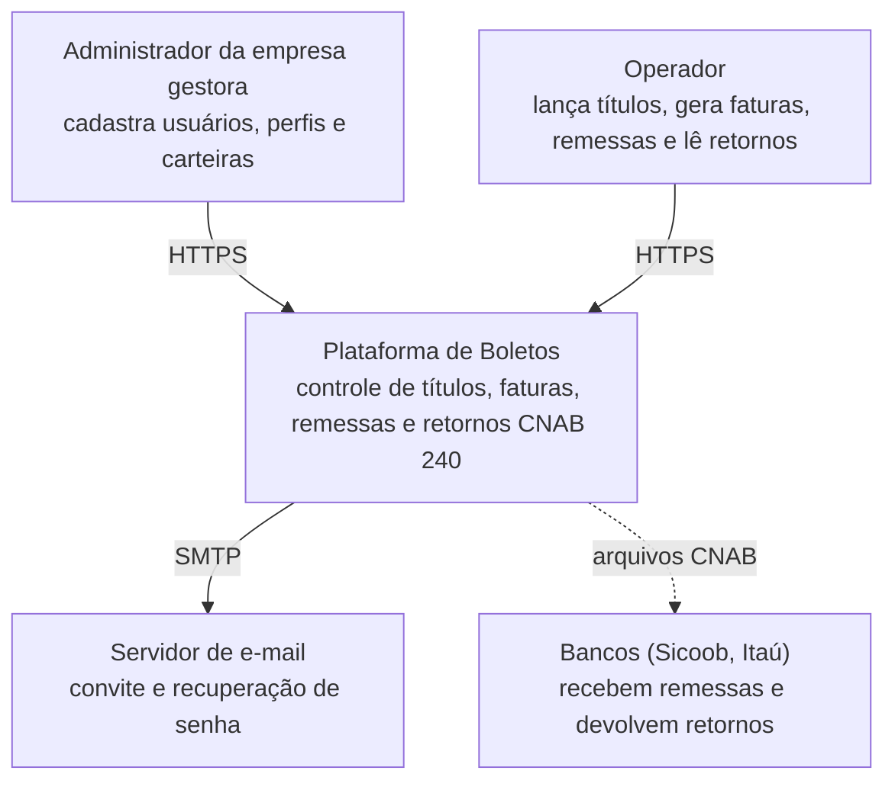

# Contexto do sistema

- Os arquivos CNAB trafegam entre o sistema e o banco por upload e download manual do usuário nesta fase. Não há integração direta com a API dos bancos.
- O servidor de e-mail é o Mailpit em desenvolvimento e o Amazon SES na AWS.
- A troca de arquivos com o banco só entra na fase dos módulos de Carteira e Boletos.

## Atores

| Ator | Função |
|---|---|
| Administrador da empresa gestora | Cadastra usuários, perfis de acesso, empresas clientes, bancos e carteiras |
| Operador | Cadastra títulos, gera faturas por competência, gera remessas e processa retornos |
| Banco | Recebe a remessa e devolve o retorno no formato CNAB 240 |
