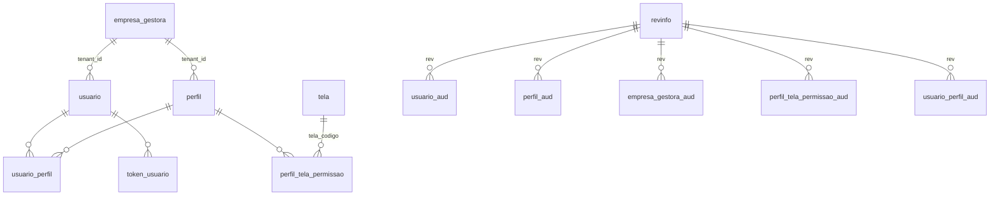

# Modelo de dados (V1)

Schema `boleto`, criado pela migração `V1__schema_inicial.sql` do `boleto-migrations` e ajustado pela `V2__auditoria_empresa_gestora_tenant.sql` e ampliado pela `V3__cpf_do_usuario.sql`. As decisões estão nos [ADR 0025](../adr/0025-modelo-de-dados-v1.md), [ADR 0026](../adr/0026-roles-e-rls.md) e [ADR 0029](../adr/0029-permissao-por-tela.md), e a V3 no [ADR 0056](../adr/0056-v3-cpf-do-usuario.md). O Task 8 mapeia estas tabelas em entidades.

## Convenções

- `id uuid primary key default uuidv7()`, exceto `tela` (chave `codigo`), `revinfo` (`rev`) e as tabelas de ligação.
- `criado_em` e `atualizado_em` (`timestamptz`) e `versao bigint` (lock otimista do Hibernate) nas tabelas de negócio.
- Toda tabela de negócio tem `tenant_id uuid not null`. Onde há ligação entre tabelas do mesmo tenant, a chave estrangeira é composta `(tenant_id, id)`, para que uma ligação nunca cruze empresas.
- RLS ligado e forçado (`ENABLE` e `FORCE ROW LEVEL SECURITY`) em toda tabela com `tenant_id` e em `empresa_gestora`. Sem `app.tenant_id` nenhuma linha passa.
- Nenhum dado de CPF na V1. O CPF entra na V3 (Task 10), cifrado em coluna ([ADR 0015](../adr/0015-lgpd.md), [ADR 0054](../adr/0054-cpf-criptografado-e-blind-index.md) e [ADR 0056](../adr/0056-v3-cpf-do-usuario.md)). A V2 foi usada pelo gatilho da auditoria da empresa.

## Tabelas

| Tabela | Conteúdo e restrições principais |
|---|---|
| `empresa_gestora` | O `id` é o tenant. `nome`, `cnpj varchar(14)` único (12 caracteres `0-9A-Z` e 2 dígitos, aceita o CNPJ alfanumérico), `plataforma` (só uma `true`, a Titulize), `ativa` (a plataforma é sempre ativa). Sem `tenant_id` |
| `usuario` | `tenant_id`, `nome`, `email` único em toda a plataforma e sempre em minúsculas, `senha_hash` (nulo enquanto `CONVIDADO`), `situacao` (`CONVIDADO`, `ATIVO`, `BLOQUEADO`, `INATIVO`; `ATIVO` exige senha). Desde a V3: `cpf_cifrado` (AES-256-GCM, 39 bytes), `cpf_indice` (HMAC-SHA256, 32 bytes, único por tenant quando preenchido) e `cpf_chave_versao`, os três nulos ou os três preenchidos. A aplicação não apaga usuário: inativa |
| `perfil` | `tenant_id`, `nome` (único por empresa, sem diferenciar maiúsculas), `descricao` |
| `tela` | Catálogo global, sem `tenant_id`. `codigo`, `nome`, `menu`, `ordem`, `somente_plataforma`, `permite_incluir`, `permite_alterar`, `permite_excluir`, `ativa`. Criado só por migração. A aplicação lê tudo e altera apenas `nome`, `menu` e `ordem`, e só com origem na plataforma |
| `perfil_tela_permissao` | Permissão por tela e por ação (`visualizar`, `incluir`, `alterar`, `excluir`) concedida ao perfil. Qualquer ação exige `visualizar`. Um gatilho recusa ação que a tela não permite e tela `somente_plataforma` para perfil de empresa que não é a plataforma |
| `usuario_perfil` | Liga usuário e perfil do mesmo tenant. O usuário herda a união das permissões dos perfis. Não há permissão direta no usuário |
| `token_usuario` | Convite e recuperação de senha. Guarda só o SHA-256 do token (`token_hash bytea`, 32 bytes, único), `finalidade` (`CONVITE` ou `RECUPERACAO_SENHA`), `expira_em` e `usado_em`. Usada desde o Task 10 ([ADR 0051](../adr/0051-tokens-de-convite-e-recuperacao-de-senha.md)): no máximo um token pendente por usuário e finalidade. Não é auditada |
| `revinfo` | Revisão do Envers: `rev` (sequence `revinfo_seq`, incremento 50), `revtstmp` (epoch em ms), `usuario_id`, `tenant_id` (efetivo) e `tenant_origem_id` (preenchido quando o admin da plataforma atua em outra empresa) |
| `*_aud` | `empresa_gestora_aud`, `usuario_aud` (sem `senha_hash` e sem colunas de CPF), `perfil_aud`, `perfil_tela_permissao_aud`, `usuario_perfil_aud`. `rev`, `revtype` (0, 1 ou 2) e as colunas da entidade. A aplicação só faz `SELECT` e `INSERT` |

O catálogo `tela` não é auditado pelo Envers na V1 nem na V2: ele muda só por migração, que o `flyway_schema_history` registra. O [ADR 0039](../adr/0039-auditoria-do-catalogo-tela.md) decidiu auditar nome, menu e ordem numa `tela_aud`, criada junto com a entidade `Tela` na tarefa do "Cadastro de Telas". Até lá, a reorganização pela tela fica fora da auditoria.

**V2 (`V2__auditoria_empresa_gestora_tenant.sql`).** A `empresa_gestora` não tem `tenant_id` (o `id` é o tenant), e a `empresa_gestora_aud.tenant_id` é `NOT NULL`. Um gatilho `BEFORE INSERT` em `empresa_gestora_aud` faz `tenant_id := id`, porque o Envers não consegue preencher a coluna ([ADR 0042](../adr/0042-v2-tenant-da-auditoria-da-empresa.md)). A `revinfo_seq` com incremento 50 e o `revtype smallint` foram conferidos pelo backend com `ddl-auto=validate` contra o schema real ([ADR 0036](../adr/0036-schema-real-nos-testes-do-backend.md)).

## Task 9: sem migração

O Task 9 não muda o schema. O bloqueio por tentativas fica no Valkey ([ADR 0047](../adr/0047-rate-limiting-e-bloqueio-de-conta.md)). As tabelas `perfil_aud`, `perfil_tela_permissao_aud` e `usuario_perfil_aud` já existem, e o backend passa a auditá-las. O backend passa a mapear `usuario.senha_hash` (fora da auditoria). Os grants da V1 bastam.

## Task 10: V3
A `V3__cpf_do_usuario.sql` acrescenta a `usuario` as colunas `cpf_cifrado`, `cpf_indice` e `cpf_chave_versao`, o check `usuario_cpf_ck` e o índice único parcial `usuario_tenant_cpf_indice_uk` em `(tenant_id, cpf_indice)` onde `cpf_indice is not null` ([ADR 0056](../adr/0056-v3-cpf-do-usuario.md)). É só acréscimo: o backend do Task 9 continua compatível. Não há grant novo nem mudança de RLS, e a `usuario_aud` não ganha coluna de CPF. O banco nunca vê o CPF em claro nem as chaves. O backend cifra e calcula o índice ([ADR 0054](../adr/0054-cpf-criptografado-e-blind-index.md)).

## Dados da V1

| Dado | Valor |
|---|---|
| Empresa da plataforma | Titulize, `plataforma = true`, UUID fixo `00000000-0000-7000-8000-000000000001`. O CNPJ é de teste e configurável (variável `FLYWAY_PLACEHOLDERS_TITULIZE_CNPJ`, aplicada a cada execução pelo `afterMigrate`) |
| Telas | `USUARIOS`, `PERFIS`, `EMPRESA_GESTORA` e `AUDITORIA` (menu Administração), `PLATAFORMA_EMPRESAS` e `TELAS` (menu Plataforma, `somente_plataforma`) |
| Perfil | `Administrador da plataforma`, na Titulize, com todas as telas e todas as ações que cada tela permite. O admin inicial do Task 9 recebe este perfil |
| Usuários | Nenhum |

"Assumir empresa" (a barra do admin) é a ação `visualizar` da tela `PLATAFORMA_EMPRESAS`. O banco só deixa conceder essa tela a perfis da Titulize.

## Funções e papéis

| Objeto | Uso |
|---|---|
| `tenant_atual()`, `tenant_origem_atual()` | Leem `app.tenant_id` e `app.tenant_origem_id` (nulo se vazio) |
| `eh_plataforma(uuid)` | Diz se a empresa é a da plataforma |
| `resolver_tenant_por_email(text)`, `resolver_tenant_por_token(bytea)` | Resolvem o tenant antes do login. Devolvem só o `tenant_id`. O token só vale se não expirou e não foi usado |
| `buscar_empresas_gestoras(termo, limite)` | Busca para a barra do admin. Só devolve linhas com origem na plataforma |
| `boleto_owner`, `boleto_app`, `boleto_funcoes` | Dona dos objetos, role do backend (só DML, sem `BYPASSRLS`) e dona das funções `SECURITY DEFINER` |

## Dados pessoais (LGPD)

Os campos pessoais do schema (`usuario.nome`, `usuario.email`, `usuario.senha_hash`, as colunas de CPF, `usuario_aud` e `token_usuario.token_hash`) estão no [Inventário LGPD](./inventario-lgpd.md), com finalidade, proteção, retenção e acesso. O Task 15 completa o inventário.
