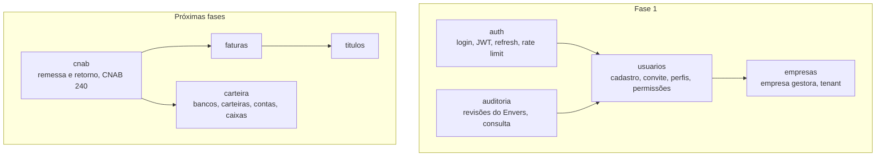

# Módulos do backend

O backend é um monólito modular organizado por funcionalidade. Cada módulo expõe uma API pública pequena. Dependências proibidas entre módulos viram teste que falha (Spring Modulith e ArchUnit).



## Estrutura de pacotes

```text
br.com.titulize.boleto
├── auth            módulo
│   ├── api         controllers e DTOs (público)
│   ├── domain      regras e portas
│   └── infra       JPA, Valkey, SMTP (privado)
├── usuarios
├── empresas
└── shared          tenant, erros, segurança, observabilidade
```

- Hoje cada módulo só tem o `package-info.java`, sem classes de negócio. As camadas `api`, `domain` e `infra` entram com o código dos Tasks 8 a 10.
- Módulos simples ficam em camadas. Módulos complexos (CNAB e faturas) usam hexagonal leve, com o domínio isolado de framework.
- Pacote raiz confirmado no Task 7: `br.com.titulize.boleto`. Os módulos `auth`, `usuarios`, `empresas`, `auditoria` e `shared` existem no `boleto-backend` com `package-info.java` e `@ApplicationModule`, e o `ModulosTest` (Spring Modulith) verifica as dependências do diagrama acima ([ADR 0032](../adr/0032-esqueleto-do-backend.md)).
