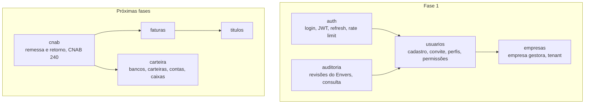

# Módulos do backend

O backend é um monólito modular organizado por funcionalidade. Cada módulo expõe uma API pública pequena. Dependências proibidas entre módulos viram teste que falha (Spring Modulith e ArchUnit).



## Estrutura de pacotes

```text
br.com.titulize.boleto
├── auth            módulo
│   ├── api         controllers e DTOs (público)
│   ├── domain      regras e portas
│   └── infra       JPA, Valkey, SMTP (privado)
├── usuarios
├── empresas
└── shared          tenant, erros, segurança, observabilidade
```

- Depois do Task 8, os módulos `empresas`, `usuarios`, `auditoria` e `shared` têm classes (tabela abaixo) e o `auth` só tem o `package-info.java`. As entidades ficam direto no pacote do módulo, sem as subcamadas `api`, `domain` e `infra`, que entram com os controllers e adaptadores dos Tasks 9 e 10.
- Módulos simples ficam em camadas. Módulos complexos (CNAB e faturas) usam hexagonal leve, com o domínio isolado de framework.
- Pacote raiz confirmado no Task 7: `br.com.titulize.boleto`. Os módulos `auth`, `usuarios`, `empresas`, `auditoria` e `shared` existem no `boleto-backend` com `package-info.java` e `@ApplicationModule`, e o `ModulosTest` (Spring Modulith) verifica as dependências do diagrama acima ([ADR 0032](../adr/0032-esqueleto-do-backend.md)).

## Classes por módulo (Task 8)

| Módulo | Classes | Depende de |
|---|---|---|
| `empresas` | `EmpresaGestora` (`@Audited`, sem `@TenantId`: o `id` é o tenant; isolada só pela RLS), `EmpresaGestoraRepository` | `shared` |
| `usuarios` | `Usuario` (`@Audited`, `@TenantId`), `SituacaoUsuario`, `UsuarioRepository`, `UsuarioServico` (`criar`, `renomear`, `alterarSituacao`) | `empresas`, `shared` |
| `auditoria` | `RevisaoAuditoria` (`revinfo`), `RevisaoAuditoriaListener`, `ConsultaAuditoria`, `RevisaoAuditada`, `Alteracao`, `DiffAuditoria` | `usuarios`, `shared` |
| `auth` | só `package-info.java`. O Task 9 é o único autorizado a ligar o `ContextoTenant` | `usuarios`, `shared` |
| `shared.tenant` | `ContextoTenant`, `ContextoTenantAusenteException`, `TenantIdResolver`, `TenantJpaDialect`, `TenantConfig` | |
| `shared.erro` | `CodigoErro`, `ErroNegocio`, `ManipuladorDeErros` | |
| `shared.log` | `TraceIdFilter` | |

A regra `contextoTenantSoLigadoPeloAuth` do `ArquiteturaTest` só admite `ContextoTenant.executar` e `chamar` em `..auth..` e `..shared.tenant..`. Detalhes em [Multi-tenancy e auditoria](./multitenancy-e-auditoria.md) e [Erros da API](./erros-da-api.md).
