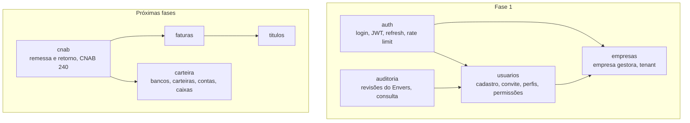

# Módulos do backend

O backend é um monólito modular organizado por funcionalidade. Cada módulo expõe uma API pública pequena. Dependências proibidas entre módulos viram teste que falha (Spring Modulith e ArchUnit).



## Estrutura de pacotes

```text
br.com.titulize.boleto
├── auth            módulo
│   ├── api         controllers e DTOs (público)
│   ├── domain      regras e portas
│   └── infra       JPA, Valkey, SMTP (privado)
├── usuarios
├── empresas
└── shared          tenant, erros, segurança, observabilidade
```

- O Task 10 acrescenta o evento `TokenDeUsuarioEmitido` (publicado por `usuarios`) e o ouvinte em `auth`, sem dependência de `usuarios` para `auth`. O `ModulosTest` continua com os mesmos cinco módulos.
- Depois do Task 8, os módulos `empresas`, `usuarios`, `auditoria` e `shared` têm classes (tabela abaixo) e o `auth` só tem o `package-info.java`. As entidades ficam direto no pacote do módulo, sem as subcamadas `api`, `domain` e `infra`, que entram com os controllers e adaptadores dos Tasks 9 e 10.
- Módulos simples ficam em camadas. Módulos complexos (CNAB e faturas) usam hexagonal leve, com o domínio isolado de framework.
- Pacote raiz confirmado no Task 7: `br.com.titulize.boleto`. Os módulos `auth`, `usuarios`, `empresas`, `auditoria` e `shared` existem no `boleto-backend` com `package-info.java` e `@ApplicationModule`, e o `ModulosTest` (Spring Modulith) verifica as dependências do diagrama acima ([ADR 0032](../adr/0032-esqueleto-do-backend.md)).

## Classes por módulo (Task 8)

| Módulo | Classes | Depende de |
|---|---|---|
| `empresas` | `EmpresaGestora` (`@Audited`, sem `@TenantId`: o `id` é o tenant; isolada só pela RLS), `EmpresaGestoraRepository` | `shared` |
| `usuarios` | `Usuario` (`@Audited`, `@TenantId`), `SituacaoUsuario`, `UsuarioRepository`, `UsuarioServico` (`criar`, `renomear`, `alterarSituacao`). Task 10: `cadastrarConvidado`, `aceitarConvite`, `redefinirSenha`, `cpfDe`, `buscarPorCpf`; `Cpf` e `@CpfValido`; `PoliticaDeSenha`; `TokenUsuarioServico` (emitir, consumir, `hash`) e o evento `TokenDeUsuarioEmitido`; `ConviteServico`; `UsuarioController` (`POST /usuarios` e `POST /usuarios/{id}/convite`). Os campos de CPF são `@NotAudited` | `empresas`, `shared` |
| `auditoria` | `RevisaoAuditoria` (`revinfo`), `RevisaoAuditoriaListener`, `ConsultaAuditoria`, `RevisaoAuditada`, `Alteracao`, `DiffAuditoria` | `usuarios`, `shared` |
| `auth` | só `package-info.java` até o Task 8. O Task 9 acrescenta login, refresh, logout, `/auth/me`, assumir empresa, limites, filtro que liga o `ContextoTenant` a partir do JWT e administrador inicial. Task 10: `SenhaController` (`definir-senha` e `esqueci-senha`, públicos), `DefinirSenhaServico`, `RecuperacaoDeSenhaServico` e `RecuperacaoAssincrona`, e o ouvinte `EnvioDeEmailDeSenha` do evento `TokenDeUsuarioEmitido`. É o único autorizado a ligar o `ContextoTenant` ([Autenticação](./autenticacao.md)) | `usuarios`, `empresas`, `shared` |
| `shared.seguranca` | Task 9: `RequerPermissao`, `Acao` e `Telas` ([ADR 0048](../adr/0048-permissoes-por-anotacao-e-assumir-empresa.md)) | |
| `shared.tenant` | `ContextoTenant`, `ContextoTenantAusenteException`, `TenantIdResolver`, `TenantJpaDialect`, `TenantConfig` | |
| `shared.erro` | `CodigoErro`, `ErroNegocio`, `ManipuladorDeErros` | |
| `shared.log` | `TraceIdFilter`. Task 10: `MascaraDeDados` (e-mail, CPF e nome para log, [ADR 0055](../adr/0055-mascara-de-dados-pessoais-nos-logs.md)) | |
| `shared.pii` | Task 10: `CifradorDeCampo` (AES-256-GCM), `IndiceCego` (HMAC-SHA256), `PiiProperties` e `PiiConfig`. Único lugar que usa `javax.crypto` ([ADR 0054](../adr/0054-cpf-criptografado-e-blind-index.md)) | |
| `shared.email` | Task 10: `EnviadorDeEmail` (interface), `EnviadorSmtp` (JavaMail), `ModeloDeEmail` e `EmailProperties` ([ADR 0053](../adr/0053-email-smtp-link-e-modelos.md)) | |

A regra `contextoTenantSoLigadoPeloAuth` do `ArquiteturaTest` só admite `ContextoTenant.executar` e `chamar` em `..auth..` e `..shared.tenant..`. Detalhes em [Multi-tenancy e auditoria](./multitenancy-e-auditoria.md) e [Erros da API](./erros-da-api.md).
