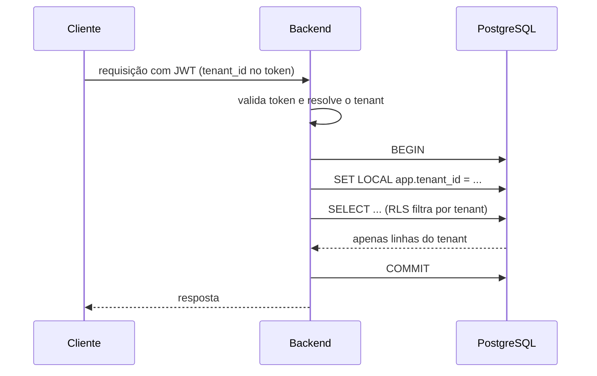

# Multi-tenancy e auditoria

## Isolamento por empresa gestora

Todas as tabelas de negócio têm `tenant_id`. O isolamento tem duas camadas:

1. **Hibernate**: `@TenantId` filtra e preenche o `tenant_id` nas consultas e gravações.
2. **PostgreSQL**: Row-Level Security. A cada transação o backend executa `SET LOCAL app.tenant_id = '<id>'`, e as políticas só liberam linhas desse tenant.

A segunda camada protege contra bugs na aplicação. A role usada pelo backend não tem `BYPASSRLS`.

### Tenant efetivo e tenant de origem

O admin da plataforma (a empresa gestora marcada como `plataforma`, a Titulize) pode assumir outra empresa pela barra superior. A aplicação define duas variáveis por transação: `app.tenant_id` (a empresa escolhida, o tenant efetivo) e `app.tenant_origem_id` (a empresa do admin). O RLS filtra pelo efetivo. A busca de empresas e o `INSERT` de empresa só valem quando a origem é a plataforma. A revisão de auditoria grava os dois. Sem `app.tenant_id` a política devolve nenhuma linha (falha fechada), e um UUID inválido dá erro. As funções `boleto.tenant_atual()` e `boleto.tenant_origem_atual()` leem as duas variáveis, e `boleto.eh_plataforma(uuid)` diz se uma empresa é a da plataforma. `app.tenant_origem_id` é uma variável de sessão que a `boleto_app` consegue alterar: o backend (Task 8) só a define a partir do JWT validado ([ADR 0030](../adr/0030-manutencao-de-dados-e-origem-do-tenant.md)). O isolamento entre empresas comuns depende só de `app.tenant_id`. Detalhes no [ADR 0025](../adr/0025-modelo-de-dados-v1.md) e no [ADR 0029](../adr/0029-permissao-por-tela.md).

### Roles e resolução do tenant antes do login

Três roles dividem o trabalho: `boleto_owner` (dona dos objetos, com `FORCE ROW LEVEL SECURITY`), `boleto_app` (a do backend, só DML, sem `BYPASSRLS`) e `boleto_funcoes` (dona das funções de resolução). Antes do login ainda não há tenant ativo. O backend chama funções `SECURITY DEFINER` (`resolver_tenant_por_email`, `resolver_tenant_por_token`) que devolvem só o `tenant_id` (o token chega como hash SHA-256 em `bytea`), e a partir daí define `app.tenant_id`. A `buscar_empresas_gestoras(termo, limite)` alimenta a barra do admin e só devolve linhas quando a origem é a plataforma. É o caminho administrativo explícito do [ADR 0008](../adr/0008-multitenancy.md), com leitura limitada às colunas necessárias. Ver [ADR 0026](../adr/0026-roles-e-rls.md).

## Trilha de auditoria

O Hibernate Envers grava, na mesma transação da alteração, o estado anterior e o novo de cada entidade auditada. Cada revisão registra:

- usuário que fez a alteração (vindo do JWT);
- tenant efetivo e, quando um admin da plataforma atua em outra empresa, o tenant de origem;
- data e hora;
- valores anteriores e novos, de onde se calcula o diff mostrado na tela.

As tabelas de auditoria (`revinfo` e uma `<tabela>_aud` por entidade auditada) também são criadas pelo `boleto-migrations` e também têm RLS. A aplicação só consegue `SELECT` e `INSERT` nelas.

O desenho das tabelas está em [Modelo de dados](./modelo-de-dados.md). O 
evinfo usa a sequence 
evinfo_seq com incremento 50, como o Hibernate 7 espera. O Task 8 confirma isso com ddl-auto=validate.
