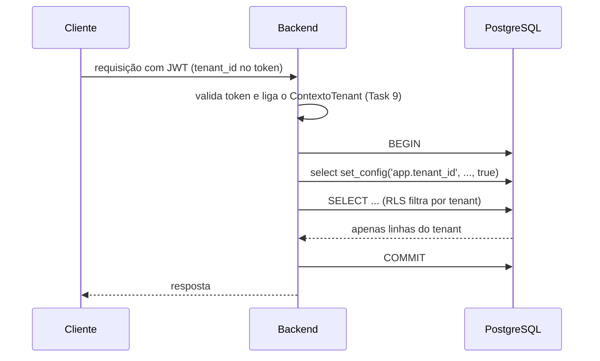

# Multi-tenancy e auditoria

## Isolamento por empresa gestora

Todas as tabelas de negócio têm `tenant_id`. O isolamento tem duas camadas:

1. **Hibernate**: `@TenantId` filtra e preenche o `tenant_id` nas consultas e gravações.
2. **PostgreSQL**: Row-Level Security. A cada transação o backend grava `app.tenant_id` e `app.tenant_origem_id` com escopo local à transação (`set_config(..., true)`, o equivalente do `SET LOCAL` com parâmetro de bind), e as políticas só liberam linhas desse tenant.

A segunda camada protege contra bugs na aplicação. A role usada pelo backend não tem `BYPASSRLS`.

### Tenant efetivo e tenant de origem

O admin da plataforma (a empresa gestora marcada como `plataforma`, a Titulize) pode assumir outra empresa pela barra superior. A aplicação define duas variáveis por transação: `app.tenant_id` (a empresa escolhida, o tenant efetivo) e `app.tenant_origem_id` (a empresa do admin). O RLS filtra pelo efetivo. A busca de empresas e o `INSERT` de empresa só valem quando a origem é a plataforma. A revisão de auditoria grava os dois. Sem `app.tenant_id` a política devolve nenhuma linha (falha fechada), e um UUID inválido dá erro. As funções `boleto.tenant_atual()` e `boleto.tenant_origem_atual()` leem as duas variáveis, e `boleto.eh_plataforma(uuid)` diz se uma empresa é a da plataforma. `app.tenant_origem_id` é uma variável de sessão que a `boleto_app` consegue alterar: o backend só a define a partir do `ContextoTenant`, que o Task 9 liga ao JWT validado ([ADR 0030](../adr/0030-manutencao-de-dados-e-origem-do-tenant.md)). O isolamento entre empresas comuns depende só de `app.tenant_id`. Detalhes no [ADR 0025](../adr/0025-modelo-de-dados-v1.md) e no [ADR 0029](../adr/0029-permissao-por-tela.md).

### Roles e resolução do tenant antes do login

Três roles dividem o trabalho: `boleto_owner` (dona dos objetos, com `FORCE ROW LEVEL SECURITY`), `boleto_app` (a do backend, só DML, sem `BYPASSRLS`) e `boleto_funcoes` (dona das funções de resolução). Antes do login ainda não há tenant ativo. O backend chama funções `SECURITY DEFINER` (`resolver_tenant_por_email`, `resolver_tenant_por_token`) que devolvem só o `tenant_id` (o token chega como hash SHA-256 em `bytea`), e a partir daí define `app.tenant_id`. A `buscar_empresas_gestoras(termo, limite)` alimenta a barra do admin e só devolve linhas quando a origem é a plataforma. É o caminho administrativo explícito do [ADR 0008](../adr/0008-multitenancy.md), com leitura limitada às colunas necessárias. Ver [ADR 0026](../adr/0026-roles-e-rls.md).

### De onde vem o contexto (Task 9)

O `ContextoTenant` é ligado por um filtro do módulo `auth` depois da validação do JWT, com `tid`, `tor` e `sub`. Cabeçalhos como `X-Tenant-Id` são ignorados. Assumir outra empresa é `POST /auth/assumir-empresa`, que emite um novo access token com `tid` diferente de `tor`. Threads novas não herdam o contexto: o executor `executorComContexto` o religa ([ADR 0050](../adr/0050-contexto-de-tenant-jwt-e-threads.md), [Autenticação](./autenticacao.md)).

## Trilha de auditoria

O Hibernate Envers grava, na mesma transação da alteração, o estado anterior e o novo de cada entidade auditada. Cada revisão registra:

- usuário que fez a alteração (vindo do JWT);
- tenant efetivo e, quando um admin da plataforma atua em outra empresa, o tenant de origem;
- data e hora;
- valores anteriores e novos, de onde se calcula o diff mostrado na tela.

As tabelas de auditoria (`revinfo` e uma `<tabela>_aud` por entidade auditada) também são criadas pelo `boleto-migrations` e também têm RLS. A aplicação só consegue `SELECT` e `INSERT` nelas.

A partir do Task 9, `perfil`, `perfil_tela_permissao` e `usuario_perfil` também são `@Audited` no backend (as tabelas `_aud` já existem na V1). A senha continua fora da auditoria. O usuário de sistema `00000000-0000-7000-8000-0000000000ff` grava as revisões do administrador inicial ([ADR 0049](../adr/0049-administrador-inicial.md)).

O desenho das tabelas está em [Modelo de dados](./modelo-de-dados.md). A `revinfo` usa a sequence `revinfo_seq` com incremento 50, como o Hibernate 7 espera, e o `ddl-auto=validate` do backend a confirma contra o schema real ([ADR 0036](../adr/0036-schema-real-nos-testes-do-backend.md)).

## Como o backend implementa (Task 8)

### Contexto de tenant

O `ContextoTenant` (`shared.tenant`) guarda `tenantId` (efetivo), `tenantOrigemId` e `usuarioId` num `ScopedValue`. Só código do servidor o liga: hoje, os testes. Depois do Task 9, só o módulo `auth` (regra `contextoTenantSoLigadoPeloAuth` do ArchUnit). Nenhum controller, filtro ou cabeçalho lê tenant ou usuário do cliente, e o `X-Tenant-Id` é ignorado. Decisão no [ADR 0037](../adr/0037-contexto-de-tenant-por-transacao.md).

| Peça | O que faz |
|---|---|
| `TenantIdResolver` | Entrega o tenant ao `@TenantId` do Hibernate. Sem contexto, lança `ContextoTenantAusenteException` e a sessão não abre |
| `TenantJpaDialect` | Logo depois do `begin`, executa `select set_config('app.tenant_id', ?, true), set_config('app.tenant_origem_id', ?, true)` |
| `TenantConfig` | Troca o dialeto do `JpaTransactionManager` por um `BeanPostProcessor` |

O valor com escopo local some no commit e no rollback, então não vaza entre conexões do pool. Fora de uma transação o banco devolve 0 linhas. O `@TenantId` está em `Usuario`. A `EmpresaGestora` não tem `@TenantId` (o `id` dela é o tenant), e o isolamento dela é só a RLS.

Limites conhecidos: `@Async` e threads virtuais não herdam o `ScopedValue` e falham fechado; não há teste de `REQUIRES_NEW` com outro contexto nem de transação `readOnly`.

### Revisão e diff

A `RevisaoAuditoria` (`revinfo`) e o `RevisaoAuditoriaListener` ficam no módulo `auditoria`. O listener lê o `ContextoTenant` e grava usuário, tenant efetivo e o tenant de origem (só quando difere do efetivo). Sem contexto, a escrita auditada falha. `EmpresaGestora` e `Usuario` são auditadas. `criado_em`, `atualizado_em` e `versao` são `@NotAudited`, e `senha_hash` não é mapeada. O `tenant_id` da `empresa_gestora_aud` vem de um gatilho da migração V2 ([ADR 0042](../adr/0042-v2-tenant-da-auditoria-da-empresa.md)).

`ConsultaAuditoria.historico(Class, id)` devolve as revisões com o diff (`campo`, `anterior`, `novo`), calculado por reflexão entre retratos consecutivos ([ADR 0038](../adr/0038-auditoria-com-envers.md)). É só serviço: não há endpoint antes da autenticação. A auditoria do catálogo `tela` está decidida e fica para a tarefa do Cadastro de Telas ([ADR 0039](../adr/0039-auditoria-do-catalogo-tela.md)).

### Erros e logs

Os erros saem em Problem Details com `codigo` e `traceId` ([Erros da API](./erros-da-api.md), [ADR 0040](../adr/0040-problem-details-e-catalogo-de-erros.md)). Os logs saem em JSON com o mesmo `traceId` ([ADR 0041](../adr/0041-logs-json-com-traceid.md)).
