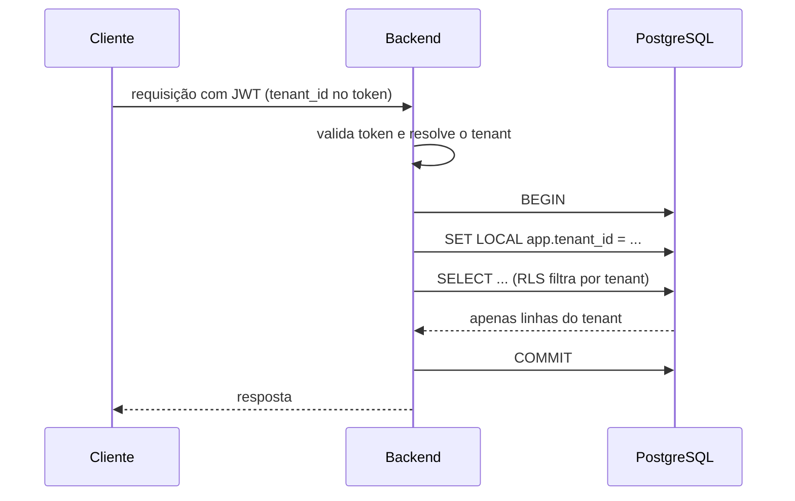

# Multi-tenancy e auditoria

## Isolamento por empresa gestora

Todas as tabelas de negócio têm `tenant_id`. O isolamento tem duas camadas:

1. **Hibernate**: `@TenantId` filtra e preenche o `tenant_id` nas consultas e gravações.
2. **PostgreSQL**: Row-Level Security. A cada transação o backend executa `SET LOCAL app.tenant_id = '<id>'`, e as políticas só liberam linhas desse tenant.

A segunda camada protege contra bugs na aplicação. A role usada pelo backend não tem `BYPASSRLS`.

## Trilha de auditoria

O Hibernate Envers grava, na mesma transação da alteração, o estado anterior e o novo de cada entidade auditada. Cada revisão registra:

- usuário que fez a alteração (vindo do JWT);
- tenant;
- data e hora;
- valores anteriores e novos, de onde se calcula o diff mostrado na tela.

As tabelas de auditoria também são criadas pelo `boleto-migrations` e também têm RLS.
